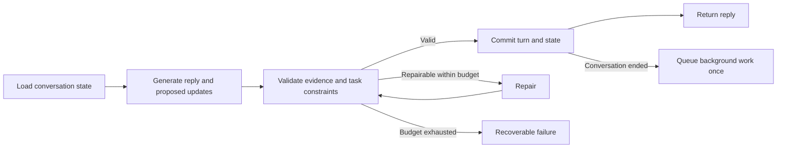

# LangGraph conversation pilot

Recorded 8 November 2026. **Status: documented and deferred; not implemented or run.**

The user wants to revisit implementation later this week. This is a tentative
planning intention, not a scheduled run or deployment commitment. Resume when
the user asks; do not automatically install dependencies, run paid evaluations,
or change production behaviour from this document.

## Objective and conversation quality gate

Strengthen conversational continuity, attribution, correction handling and
recovery before pursuing further model selection. Keep the existing Claude
model fixed during the pilot so architecture and model changes can be evaluated
separately.

**Will this change positively or negatively affect the conversation experience?**

Expected positive effect: Groucho remembers the right person’s facts, respects
corrections, follows unfinished threads and recovers without repeating messages.
Potential negative effects: rigid branching, compulsory questions, added model
calls and delays, or abrupt endings. Resolve these through a small graph,
flexible responses and complete-conversation review before any rollout.

LangGraph is a candidate orchestration runtime, not a source of conversational
judgement. Establish whether its persistence and control-flow benefits justify
the additional dependency and operational complexity.

## Current implementation to inspect when resuming

- [Conversation engine](../lib/conversation-engine.ts): generation, streaming,
  response validation, bounded repair, choices, closing and persistence.
- [Conversation memory](../lib/conversation-memory.ts): grounded notes for the
  visitor, other people, corrections and threads. The current merge appends and
  deduplicates notes; it does not explicitly supersede an earlier claim.
- [Completion jobs](../lib/session-completion-jobs.ts): background work after
  conversation completion.
- [Background model comparison](../evals/background-models/REPORT-2026-11-08.md):
  synthetic evidence of attribution, correction and sensitive-data issues.
  This is context for the pilot, not proof of live conversational failures.

Re-read these files and the applicable repository instructions before coding;
other work may change the baseline between planning and implementation.

## Proposed implementation decisions

1. **Version grounded facts.** Store a stable fact ID, subject, source message
   ID, exact supporting quote and active/superseded status. Proposed corrections
   identify which earlier claim they supersede. Validate references and evidence;
   a quoted phrase alone does not prove the model’s interpretation. Preserve the
   original transcript and distinguish explicit claims from uncertain inferences.
2. **Track unfinished threads.** Represent unanswered visitor questions and
   ongoing stories separately from required task fields. A resolved thread or an
   explicit refusal should not trigger another probe. Do not turn the thread
   list into a mandatory interview checklist.
3. **Separate task and conversation completion.** Selecting a date can complete
   a preference while a story continues. A visitor can end an incomplete task.
   Ending the conversation never implies acceptance or an eligibility decision.
4. **Keep booking validation deterministic.** Approved dates, availability and
   required booking fields remain separate from conversational judgement.
5. **Keep natural responses flexible.** Groucho may answer, acknowledge,
   contribute or ask a useful question. Do not require a question on every turn,
   route by isolated phrases, or create a node for every conversational topic.
6. **Use one normal generation call.** Let it propose a reply and state updates.
   Validate deterministically where possible. Additional calls are bounded
   recovery steps, not one model call per graph node. Retain an explicit latency
   and cost budget.
7. **Make persistence and retries coherent.** Choose one authoritative state
   model and define how graph checkpoints relate to stored messages. Use
   project/session scoping, turn idempotency keys and session-version checks.
   Graph replay must not duplicate messages, completion jobs or other effects.
   A checkpointer alone does not provide exactly-once external writes.
8. **Define streaming semantics.** Decide which checks must precede visible
   output. A rejected draft must not be shown and silently replaced. Compare
   buffering versus incremental validation against perceived response speed.
9. **Constrain memory use.** Keep memory session-scoped for this pilot and align
   checkpoint retention/deletion with conversation data. Do not introduce
   cross-applicant memory. Decide which corrected facts background tasks can
   consume without treating the memory as unquestionable ground truth.

## Small graph to prototype

Implementation must explicitly reconcile the commit/return steps with streaming;
the diagram describes logical responsibilities, not a final transport design.

## Implementation sequence for the deferred work

1. Select one isolated demo conversation profile, record the exact baseline
   model/configuration and define acceptance thresholds before running comparisons.
2. Specify state types, correction semantics, completion semantics and replay
   fixtures first. Resolve uncertainty about attribution without inventing facts.
3. Prototype the small graph behind a default-off feature flag. Preserve the
   existing route contract and keep the current engine available for rollback.
4. Test state transitions, interruptions, duplicate submissions and persistence
   failures with synthetic fixtures before any live model evaluation.
5. Run matched full conversations through the baseline and pilot with the same
   model and inputs. Review complete conversations, not isolated replies or JSON
   validity alone. Record latency, cost, repair frequency and failures.
6. Document findings and decide whether to retain LangGraph, revise the design
   or keep the state improvements without adopting the runtime. Broader rollout
   is a separate decision after the pilot meets its quality gate.

## Acceptance criteria and review cases

| Case | Required behaviour |
| --- | --- |
| “That was my brother; I can help monthly.” | Supersede the visitor attribution; preserve the brother’s role and monthly availability. |
| Assistant suggests an interest; visitor rejects it | Do not save the suggestion as a visitor fact. |
| Visitor asks a direct question | Answer from approved context, acknowledge unknowns, and avoid a compulsory follow-up. |
| Visitor says they cannot explain or declines | Respect the limit and do not repeatedly re-probe it. |
| Date selected during an unfinished story | Complete the task state without abruptly ending the conversation. |
| Visitor explicitly ends the chat | End respectfully even with incomplete optional details; make no eligibility promise. |
| Request times out, retries or arrives twice | No duplicated visible turn or background completion work; resume consistent state. |
| Draft needs repair | No rejected draft leaks into the visible transcript; recovery stays bounded. |
| Sensitive personal information is volunteered | Follow an explicit minimisation policy in durable memory and background outputs. |

Review warmth, continuity, curiosity, useful contribution, correct attribution
and respectful corrections across complete conversations. Record repeated
questions, premature endings, ungrounded claims, time to first visible text,
total turn latency, model calls per turn and cost per completed conversation.
Mechanical correctness and improved average scores cannot excuse material
conversation-quality regressions. Agree numeric performance thresholds at kickoff
against the then-current baseline; they are not established by this proposal.

## Out of scope

No model switch, multi-agent redesign, live applicant-data evaluation,
eligibility/scoring change, production migration, mandatory hosted tracing or
automatic rollout. No dependency installation or runtime changes were made to
document this proposal. No reminder or scheduled execution was created.

## Reference documentation

Recheck current APIs and versions when implementation begins:

- [LangGraph TypeScript overview](https://docs.langchain.com/oss/javascript/langgraph/overview)
- [State and workflow design](https://docs.langchain.com/oss/javascript/langgraph/thinking-in-graph-api)
- [Persistence and checkpointing](https://docs.langchain.com/oss/javascript/langgraph/persistence)
