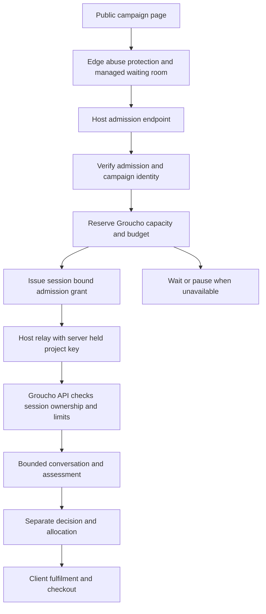

# Public drop resilience and waiting rooms

5 November 2026. Product proposal and provider evaluation for Groucho. This is not a deployment runbook or a claim that the proposed safeguards are live.

Groucho needs controlled admission before a public visitor can consume AI capacity. A valuable public link can attract both genuine demand and automated abuse. A conversational application alone does not protect availability, fairness or spending. The recommended direction is managed traffic protection and waiting rooms, backed by Groucho's own distributed session, concurrency and cost controls.

Evaluate Cloudflare first and Queue-it alongside it. Choose against measured conversation capacity, campaign isolation, client integration and total cost. No independent performance benchmark was conducted for this comparison; the shortlist reflects documented integration capabilities, not a universal vendor ranking.

## Product requirements

There are four different problems to solve:

| Problem | Required behaviour |
| --- | --- |
| Sudden legitimate demand | Hold excess visitors outside the application and admit them at a sustainable rate. |
| Automated abuse | Reject or challenge suspicious traffic before expensive work, and limit attempts that pass the checks. |
| AI and infrastructure costs | Bound work per request, session, campaign and platform, including work already in flight. |
| Fair allocation | Keep admission to apply separate from suitability, approval and ticket or product entitlement. |

Bot detection inside the conversation happens after expenditure. Email-pattern checks, cultural knowledge and response timing may contribute evidence, but cannot serve as the primary availability or spending controls. OWASP describes uncontrolled model use as unbounded consumption, including denial of service and financial exhaustion. [OWASP LLM10](https://genai.owasp.org/llmrisk/llm102025-unbounded-consumption/)

Offer three campaign modes:

- **Invitation only:** individual, expiring invitations, bounded attempts and resumable sessions. Suitable for a controlled pilot; a forwarded link must not create unlimited fresh conversations.
- **Protected public:** an inexpensive public page, admission checks, campaign capacity limits and a waiting experience when demand exceeds capacity.
- **Scheduled public drop:** protected public access with a defined opening time, a published admission policy and optional pre-queue. Queue order does not itself award inventory.

Selective distribution reduces initial exposure but does not replace technical controls. An invitation is an access credential; merely matching the supplied email to the invitation does not independently verify inbox ownership.

## Current repository evidence

This is a targeted source review, not an audit of deployed infrastructure or every API path.

| Area | Evidence and boundary |
| --- | --- |
| Host relay | [Client integration](../docs/client-integration-guide.md) keeps project keys on the host server. An unauthenticated relay can still attach a valid key to abusive browser traffic. |
| Invitations | [Invitation helpers](../lib/application-invitations.ts) store token hashes and check project, expiry and revocation. Gatekeeper start enforces configured invitations against session, email and audience in [start handler](../lib/start-gatekeeper-session.ts). This is an existing foundation, not a universal one-time invitation system across all runtimes. |
| Rate limiting | [Rate limiter](../lib/rate-limit.ts) uses a process-local map. [Message handling](../lib/post-session-message.ts) applies API-key and session buckets. These do not establish a shared quota across instances or restarts. |
| Start surface | [Start route](../app/v1/sessions/[sessionId]/start/route.ts) resolves the project and selects a runtime. A common, distributed admission and cost gate across starts, messages and other billable paths remains a requirement to verify and implement. |
| Runtime controls | [Shared engine](../lib/conversation-engine.ts) already bounds model output and has timeouts/retry settings. Those limits are not campaign spending caps. |
| Load test | [Existing k6 script](../loadtests/k6/chat-messages.js) exercises a small message workload. It does not establish public-drop capacity, queue correctness or resistance to distributed abuse. |
| Simulated culture load tests | [Local harness](../loadtests/culture/README.md) now exercises complete Lewisham conversations with synthetic AI, resume and persistence checks, and 100/200 applicant scenarios. Harness verification uses an in-memory database adapter; real database and deployed capacity need separate runs. |
| Decisions and fulfilment | [Runtime map](../docs/architecture.md) separates conversation, assessment, decision, allocation and client fulfilment. Queue admission must preserve these boundaries. |

A managed waiting room, platform-wide spending enforcement and multi-instance admission controls were not established by this review. Verify the deployed environment separately before making launch claims.

## Provider comparison

| Option | Why evaluate it | Fit and limitations for Groucho |
| --- | --- | --- |
| Cloudflare Waiting Room | Managed admission near the network edge, with Cloudflare traffic protection available around it. | First evaluation for a Groucho-owned public entry point. Validate minimum thresholds, campaign routing and plan restrictions. |
| Queue-it | Dedicated waiting-room product with edge and server connectors, scheduled pre-queues and invite-only patterns. | Main alternative for client-owned stacks and event-specific requirements. Use an edge or server integration, not a browser script alone. |
| Queue-Fair | Managed waiting rooms with server and network-edge adapters. | Additional commercial comparison; test its signed admission and adapter fit against the same requirements. |
| Custom admission service | Full control over low admission rates, costs and campaign rules. | Groucho should own resource limits, but building the entire public queue adds responsibility for ordering, recovery, abuse, scaling and support. |

Queue-it documents signed return tokens and server validation, and explicitly notes that users can bypass its client-side-only connector. Scheduled pre-queues can randomise people present at opening before later arrivals join in order. [Queue-it integration](https://queue-it.com/developers/how-queue-it-works/), [server connector](https://queue-it.com/developers/connectors/node-js-connector/)

Queue-Fair documents digitally signed admission, server adapters and network-edge adapters, including Cloudflare and CloudFront. A server adapter still receives requests at the origin; an edge adapter rejects earlier. These are vendor descriptions to validate in a proof of concept. [Queue-Fair developer documentation](https://queue-fair.com/developers)

Do not adopt the old AWS Virtual Waiting Room solution as a maintained shortcut: AWS has discontinued it and its repository is archived. AWS-hosted clients can evaluate supported vendors or a separately maintained design. [AWS discontinuation notice](https://aws.amazon.com/solutions/implementations/virtual-waiting-room-on-aws/), [archived source](https://github.com/aws-solutions/virtual-waiting-room-on-aws)

## Cloudflare capabilities and constraints

### Plans and commercial scope

Cloudflare currently includes one basic FIFO waiting room on Business and Enterprise, with none on Free or Pro. Enterprise Advanced adds capabilities such as customised templates, multiple routes, JSON responses, scheduled events, session revocation and additional queueing methods. The basic room's Turnstile failure action is logging; the infinite-queue action requires Advanced. These distinctions affect a branded, multi-campaign Groucho product. Confirm contract pricing, room counts, support and related traffic-protection charges before choosing. [Features by plan](https://developers.cloudflare.com/waiting-room/plans/)

### Capacity settings

Cloudflare exposes active-user and new-user admission thresholds. Its configuration guide currently says both must be greater than 200; this may be too coarse for a small AI campaign. Confirm actual supported minima with Cloudflare. These visitor thresholds also do not measure active model calls or model tokens. Groucho needs a stricter internal limiter if its measured safe capacity is lower. Path coverage includes subpaths and does not support wildcard paths or query parameters. Use explicit campaign paths rather than query strings for routing. [Configuration reference](https://developers.cloudflare.com/waiting-room/reference/configuration-settings/)

### Browser and API integration

Prefer a browser entry page for the first proof of concept. Cloudflare's JSON mode requires cookie continuity and polling, and its integrated Turnstile challenge is not supported on JSON responses. The SDK/host must understand queued responses rather than treating waiting-room HTML as conversation JSON. A separate admission challenge must be validated server-side and bound to the application session. [JSON response integration](https://developers.cloudflare.com/waiting-room/how-to/json-response/)

Standalone Turnstile requires server-side verification; its tokens expire after five minutes and are single-use. Check expected hostname/action and issue a separate resumable application session after admission. Do not reuse a Turnstile token as a durable conversation credential or as proof of ticket entitlement. [Turnstile verification](https://developers.cloudflare.com/turnstile/get-started/server-side-validation/)

### Hosting and domains

Start with one Groucho-owned campaign hostname and a defined origin, keeping dashboard access out of the applicant queue. Routing applicants through Cloudflare does not require moving the conversation engine onto Workers. Every alternate origin, deployment hostname and direct API route needs an explicit bypass-prevention design.

For client-owned domains, establish who controls DNS, edge rules, sessions and the relay. Cloudflare documents a Waiting Room integration with Cloudflare for SaaS custom hostnames; eligibility, commercial terms and room isolation need confirmation for our deployment. [Cloudflare for SaaS](https://developers.cloudflare.com/waiting-room/additional-options/ssl-for-saas/)

If the selected origin is on Vercel, account for its recommendation against adding a reverse proxy because this can reduce firewall visibility and cause usage spikes. Its supported-proxy guidance includes Cloudflare with `CF-Connecting-IP`, but that does not resolve every integration issue. Validate trusted visitor IP forwarding, firewall behaviour, caching, cookies, streaming and direct deployment URL access. Do not assume that two independent protection layers automatically compose correctly. [Vercel reverse-proxy guidance](https://vercel.com/docs/security/reverse-proxy)

## Proposed Groucho integration

The managed queue controls arrival pressure. Groucho is the authority on whether more billable work is permitted. A queue slot, an admitted application session, an approved application and a redeemable ticket are distinct objects.

1. Serve the landing page without AI calls. Keep queue status traffic off the model path and, where possible, off the application origin.
2. Check invitations or public admission according to campaign mode. Verify provider admission using supported enforcement at the edge/server; never trust the mere presence of a cookie or a browser-supplied `admitted` flag.
3. Bind an admission grant to project/campaign, applicant session, expiry and server-controlled attempt policy. A grant authorises starting or resuming that application only. Permit safe reconnection without creating another paid attempt.
4. Enforce session ownership at the host relay and API trust boundary. Keep project keys server-side. Enforce protection on all equivalent start/message paths and alternate hostnames; API clients must not skip the public gate.
5. Use shared, atomic limits across instances. Combine campaign/global capacity with session and identity limits. Treat IP as a supplementary signal because shared networks and distributed bots make it an imperfect identity.
6. Before each paid call, atomically reserve a conservative maximum cost against campaign and global budgets, including active reservations. Reconcile actual usage afterward; handle timeouts and unknown provider usage conservatively. Bound retries, output, input context, tool calls and background work as well.
7. Serialize or safely deduplicate requests within a session. Replayed starts, messages, completion jobs and webhook retries must not create duplicate model work or entitlements.
8. Release capacity on completion, cancellation or lease expiry. Separate the number of active conversations from the number of simultaneous model calls. Protect assessment jobs and other tenants when a campaign surges.

If shared admission or budget state is unavailable, pause new expensive work. Preserve saved progress and provide an honest retry path. Reserve capacity and budget for admitted sessions if promising they can finish; otherwise explain that a session may pause. Keep operational controls available during a campaign incident.

## Capacity and cost planning

Measure complete applications, including opening calls, conversational turns, retries, assessments, profile generation and background processing. Include abandoned sessions in the cost model. Provider request/token limits, database throughput and connection limits can constrain the service before hosting compute does.

For initial planning:

- Average active conversations ≈ admissions per minute × average conversation duration in minutes.
- Model requests per minute ≈ admissions per minute × average paid calls per application, in steady state.
- Expected AI spend ≈ started applications × measured average lifecycle cost; enforcement uses conservative reservations rather than this average.

Illustration only: 20 starts per minute with an average five-minute conversation means roughly 100 active conversations. This is not a tested Groucho capacity. Burst patterns, slow users and abandonment require additional headroom.

Track arrival rate, admitted starts, queue wait and abandonment, active sessions/model calls, provider throttling, latency, error rates, challenge failures, reserved/actual spend and per-campaign capacity. Cap email verification, logging, database work and queue polling too; an AI budget does not bound the whole operating bill.

## Validation before a public drop

Use staging and a stubbed model for high-volume scenarios, followed by a small bounded live-model test to confirm latency and cost assumptions. Extend the existing load test to cover the complete selected runtime and admission path.

| Scenario | Required result |
| --- | --- |
| Large burst of genuine visitors | Excess visitors wait; application concurrency remains within the configured envelope. |
| Distributed bots and fresh session IDs | Campaign/global limits remain effective despite identity rotation. |
| Direct API, relay and alternate-host requests | Unadmitted traffic cannot initiate paid work. |
| Duplicate requests, multiple tabs and reconnects | One intended attempt; no duplicate model work or lost progress. |
| Simultaneous budget reservations | Admitted work cannot exceed the configured reserved budget. |
| Provider throttling or failure | Bounded retries, saved progress and controlled pause without a retry storm. |
| Admission-store or queue failure | Explicit fallback policy; no automatic unrestricted AI access. |
| Two campaigns under uneven demand | One campaign cannot exhaust capacity or funds reserved for another. |
| Accessibility and mobile browsers | Usable challenges, queue status and recovery, including cookie/session behaviour. |
| Approval and checkout replay | Queue admission never substitutes for an approval or a client-side redemption check. |

Record the tested traffic envelope and operating cost before promising launch readiness. No design can guarantee unlimited availability or complete bot exclusion.

## Evaluation and rollout

1. **Controlled pilot:** reuse the invitation foundation, verify ownership and resume semantics, add distributed request/capacity limits and enforced spending budgets.
2. **Cloudflare proof of concept:** use a staging campaign hostname, browser admission, separate session grants and explicit bypass prevention. Test threshold fit, queue/cookie behaviour and overload fallback.
3. **Queue-it comparison:** run the same scenarios with a supported connector. Obtain quotes for the same campaigns, peak arrivals, event duration and support coverage. Consider Queue-Fair if its commercial or integration fit is stronger.
4. **Public launch decision:** choose a provider only after capacity measurements, failure tests, campaign isolation and operating ownership are agreed.

Vendor questions: Can thresholds support our low-volume AI bottleneck? How many isolated campaign rooms are included? Can rooms share a global capacity envelope? What admission validation and replay protections are supported? What works with custom domains, JSON and streaming? What happens during a provider outage? What charges apply during an attack? What support is available during a scheduled drop?

Groucho product questions: Are applicants selected after a registration window or immediately? Does queue order affect eligibility? Must email be verified before admission? Who owns client-domain enforcement? How much capacity and spend can each campaign consume? What happens to applicants when a budget is exhausted?

## Pitch deck wording

### The problem

**Public demand creates an access problem before the application begins.**

A valuable link attracts genuine fans and automated traffic. Giving every arrival an AI conversation can overwhelm capacity and create uncontrolled costs. Application quality and access infrastructure must be designed together.

### Planned product capability

**Controlled access from arrival to allocation.**

Groucho's proposed public-drop flow combines invitations or managed waiting rooms, checks before paid conversations, bounded campaign capacity and spending, and a separate approval and fulfilment process. The goal is to keep applications usable under an agreed demand envelope while gathering useful audience evidence.

Mark this slide **Planned capability under evaluation** until implemented and tested. Cloudflare, Queue-it and Queue-Fair are candidates, not announced partners. Current invitations can be described in the scope documented above; do not claim proven large-drop resilience, guaranteed human identity, unlimited scale or secure ticket fulfilment on the basis of a waiting-room demonstration.
